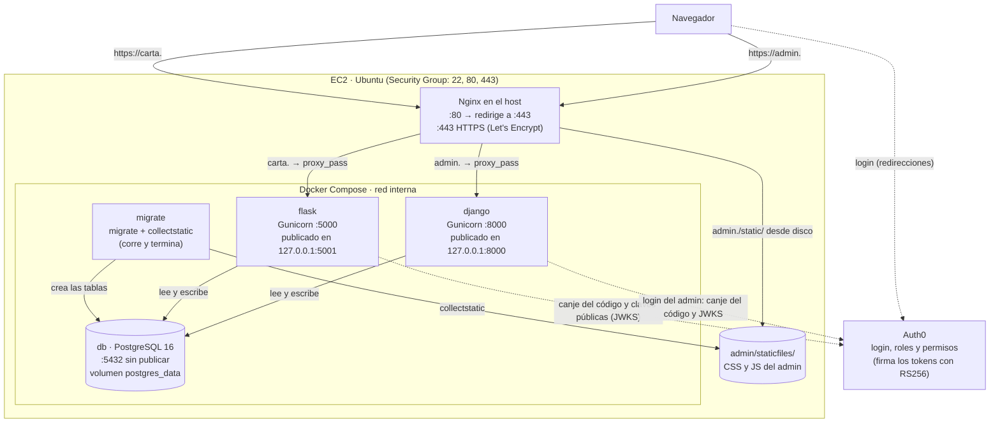

# La Carta 2.0

Restaurantes y platos (La Carta) con **pedidos**: los clientes piden, la cocina los prepara y el personal interno los administra. Dos aplicaciones sobre **una sola base PostgreSQL**:

- **Flask** (`flask/`): la carta pública, el CRUD de restaurantes y platos, los pedidos y la cola de la cocina. El login lo hace **Auth0** (Authorization Code con Authlib) y cada ruta protegida exige un permiso del token.
- **Django** (`admin/`): el admin para el personal interno, con usuarios propios de Django. Es el **dueño del esquema**: sus migraciones crean todas las tablas.

Todo corre con **Docker Compose** en una EC2, detrás de **Nginx** con HTTPS (Let's Encrypt).

## 1. URLs públicas

| Aplicación | URL |
|---|---|
| Carta (Flask) | <https://carta.lacarta-camila.duckdns.org/> |
| Admin (Django) | <https://admin.lacarta-camila.duckdns.org/admin/> |

## 2. Arquitectura



| Servicio | Puerto en el contenedor | Publicado en el host | Quién llega |
|---|---|---|---|
| Nginx (host) | — | `0.0.0.0:80` y `0.0.0.0:443` | Internet |
| `flask` | 5000 | `127.0.0.1:5001` | Solo Nginx |
| `django` | 8000 | `127.0.0.1:8000` | Solo Nginx |
| `db` | 5432 | — (sin `ports`) | Solo `flask`, `django` y `migrate`, por la red interna de Compose (nombre `db`) |
| `migrate` | — | — | Corre al levantar y termina; `flask` y `django` esperan a que termine bien (`service_completed_successfully`) |

Orden de arranque: `db` (con healthcheck) → `migrate` → `django` y `flask`.

## 3. Cómo levantarlo desde cero

### Requisitos previos

- **Auth0**: un tenant con la API `La Carta API` (Identifier `lacarta-api`, RS256, *Enable RBAC* y *Add Permissions in the Access Token*) y estos permisos y roles:

  | Permiso | cliente | cocina | admin |
  |---|:-:|:-:|:-:|
  | `create:pedidos`, `read:mis-pedidos` | ✓ | | |
  | `read:pedidos`, `update:pedidos` | | ✓ | |
  | `write:carta`, `delete:carta` | | | ✓ |
  | `write:empleados`, `delete:empleados` | | | ✓ |

  Y dos Regular Web Applications autorizadas en *API Access*: `La Carta Web` (Flask) y `La Carta Admin` (Django). Al admin de Django solo entra quien tenga `write:empleados`; no se usa `createsuperuser`.
- **Para producción**: una instancia EC2 con Ubuntu, un Security Group que solo abra los puertos **22, 80 y 443**, y un dominio que apunte a su IP pública (aquí, `lacarta-camila.duckdns.org`; los subdominios `carta.` y `admin.` resuelven a la misma IP).

### En local (desarrollo)

Requiere Docker Desktop.

```bash
git clone https://github.com/catorceno/AW1-LaCarta.git
cd AW1-LaCarta
cp .env.example .env          # y completar los valores (ver la tabla de abajo)
docker compose up -d --build
docker compose ps             # migrate: Exited (0); db, django y flask: Up
docker compose exec flask flask seed                              # datos de prueba (opcional)
```

- Carta (Flask): <http://localhost:5001> — tiene que ser `localhost`, no `127.0.0.1`, por las URLs registradas en Auth0.
- Admin (Django): <http://localhost:8000/admin/> — sin estilos en local: los estáticos los sirve Nginx en producción.
- Pruebas: `docker compose exec flask pytest -q`

En Auth0:
- *La Carta Web*: Allowed Callback URLs `http://localhost:5001/auth/callback` y Allowed Logout URLs `http://localhost:5001/`.
- *La Carta Admin*: Allowed Callback URLs `http://localhost:8000/auth/callback/` y Allowed Logout URLs `http://localhost:8000/admin/`.

### En producción (EC2 con Ubuntu)

**1. Instalar Docker, Nginx y Certbot**

```bash
curl -fsSL https://get.docker.com | sudo sh
sudo usermod -aG docker ubuntu
sudo apt update && sudo apt install -y nginx certbot python3-certbot-nginx
exit      # volver a entrar por SSH para que el grupo docker tenga efecto
```

**2. Código y variables de entorno**

```bash
git clone https://github.com/catorceno/AW1-LaCarta.git
cd AW1-LaCarta
cp .env.example .env
nano .env
chmod 600 .env       # solo el usuario ubuntu puede leerlo
```

Claves nuevas para el servidor: `python3 -c "import secrets; print(secrets.token_hex(32))"`.

| Variable | Valor en producción |
|---|---|
| `POSTGRES_PASSWORD`, `FLASK_SECRET_KEY`, `DJANGO_SECRET_KEY` | Claves aleatorias generadas en el servidor |
| `DJANGO_DEBUG` | `0` |
| `DJANGO_ALLOWED_HOSTS` | `admin.lacarta-camila.duckdns.org` |
| `DJANGO_CSRF_TRUSTED_ORIGINS` | `https://admin.lacarta-camila.duckdns.org` |
| `BEHIND_PROXY` | `1` (Flask confía en los `X-Forwarded-*` de Nginx: ProxyFix) |
| `SESSION_COOKIE_SECURE` | `1` (la cookie de sesión solo viaja por HTTPS) |
| `AUTH0_DOMAIN`, `AUTH0_AUDIENCE`, `AUTH0_CLIENT_ID`, `AUTH0_CLIENT_SECRET` | Los de *La Carta Web* y *La Carta API* en Auth0 |
| `DJANGO_AUTH0_CLIENT_ID`, `DJANGO_AUTH0_CLIENT_SECRET` | Los de *La Carta Admin* en Auth0 |
| `DJANGO_SECURE_COOKIES` | `1` (las cookies de sesión y CSRF del admin solo viajan por HTTPS) |

**3. Levantar los contenedores**

```bash
docker compose up -d --build
docker compose ps                            # migrate: Exited (0); db, django y flask: Up
docker compose logs migrate | tail           # migraciones aplicadas y collectstatic
docker compose exec flask flask seed         # opcional: datos de prueba
```

**4. Nginx: los dos subdominios**

```bash
chmod o+x /home/ubuntu                       # Nginx (www-data) necesita atravesar la carpeta para leer los estáticos
sudo cp nginx/lacarta.conf /etc/nginx/sites-available/lacarta
sudo ln -s /etc/nginx/sites-available/lacarta /etc/nginx/sites-enabled/
sudo rm /etc/nginx/sites-enabled/default
sudo nginx -t && sudo systemctl reload nginx
```

**5. HTTPS con Let's Encrypt**

```bash
sudo certbot --nginx -d carta.lacarta-camila.duckdns.org -d admin.lacarta-camila.duckdns.org
systemctl list-timers | grep certbot         # renovación automática (timer de systemd)
sudo certbot renew --dry-run                 # simula la renovación
```

Certbot agrega a `/etc/nginx/sites-available/lacarta` los bloques de 443 y la redirección de 80 a 443.

**6. Auth0**

En *La Carta Web → Settings*, agregar (sin borrar las de localhost):

- Allowed Callback URLs: `https://carta.lacarta-camila.duckdns.org/auth/callback`
- Allowed Logout URLs: `https://carta.lacarta-camila.duckdns.org/`

En *La Carta Admin → Settings*:

- Allowed Callback URLs: `https://admin.lacarta-camila.duckdns.org/auth/callback/`
- Allowed Logout URLs: `https://admin.lacarta-camila.duckdns.org/admin/`

**7. Verificar**

```bash
curl -I http://carta.lacarta-camila.duckdns.org    # 301 hacia https://
sudo ss -tlnp                                      # 5001 y 8000 solo en 127.0.0.1; 5432 no aparece
```

### Actualizar el servidor después de un cambio

```bash
cd ~/AW1-LaCarta
git pull
docker compose up -d --build
```

`migrate` vuelve a correr y aplica las migraciones nuevas antes de que arranquen `django` y `flask`.

## Cómo probar

### Pruebas automáticas

```bash
docker compose exec flask pytest -q
```

No necesitan Auth0 ni PostgreSQL: usan SQLite en memoria y firman sus propios tokens RS256 con un par de claves generado en la prueba, así que `verify_decode_jwt` corre el mismo código que en producción. Las seis obligatorias están en `flask/tests/test_pedidos.py`:

| Prueba | Qué comprueba |
|---|---|
| `test_1_sin_sesion_crear_pedido_no_crea_nada` | Sin sesión, crear un pedido responde 401 y no escribe nada |
| `test_2_cliente_no_puede_avanzar_el_estado` | Un cliente que avanza un estado recibe 403 y el estado no cambia |
| `test_3_el_total_lo_calcula_el_servidor` | Un precio, un total y un cliente inventados en el formulario se ignoran |
| `test_4_plato_no_disponible_rechaza_todo_el_pedido` | Un plato no disponible rechaza el pedido entero: ninguna fila nueva |
| `test_5_pedido_de_otro_cliente_es_404` | Ver o cancelar el pedido de otro cliente responde 404 |
| `test_6_cocina_no_puede_volver_de_listo_a_pendiente` | `listo → pendiente` responde 400 y el estado no cambia |

Además, `test_rutas_protegidas` revisa cada ruta protegida (401 sin sesión, 403 sin el permiso): si se quita el decorador de cualquiera, su caso falla.

### Usuarios de prueba

Tres usuarios en Auth0, uno por rol (`cliente`, `cocina`, `admin`), y un superusuario de Django. Las contraseñas no están en el repositorio: se entregan en papel.

| Rol | Permisos | Qué puede hacer |
|---|---|---|
| Sin sesión o sin rol | — | Ver la carta |
| `cliente` | `create:pedidos`, `read:mis-pedidos` | Hacer pedidos, ver los suyos y cancelarlos si siguen pendientes |
| `cocina` | `read:pedidos`, `update:pedidos` | Ver la cola y avanzar los estados |
| `admin` | `read:pedidos`, `write:carta`, `delete:carta` | Ver la cola y administrar restaurantes y platos |

### A mano

1. Sin sesión: abrir la carta y el detalle de un restaurante.
2. Como `cliente`: hacer un pedido de varios platos y ver el total en *Mis pedidos*.
3. Como `cocina`, en otra ventana privada: avanzar ese pedido en *Cocina*.
4. Como `cliente`: cancelar un pedido pendiente; con uno en preparación, el botón ya no aparece y el POST responde 400.
5. Cambiar el id en `/pedidos/<id>` por el de otro cliente: 404.
6. En psql, un estado inválido:
   ```bash
   docker compose exec db psql -U lacarta -d lacarta -c "INSERT INTO lacarta_pedido (cliente, restaurante_id, estado) VALUES ('x', 1, 'volando');"
   ```
   Falla con `violates check constraint "pedido_estado_valido"`.

## 4. Decisiones justificadas

### 1. Cómo apunta Flask a las tablas de Django, y por qué solo migra Django

Los modelos viven en Django (`admin/lacarta/models.py`) y sus migraciones crean las tablas `lacarta_restaurante`, `lacarta_plato`, `lacarta_pedido` y `lacarta_itempedido`, con sus `CHECK`. Flask (`flask/app/models.py`) declara esas mismas tablas con `__tablename__` y las mismas columnas, sin Flask-Migrate ni `create_all()`: solo las usa. Así hay un único dueño del esquema; si los dos migraran, cada uno intentaría crear o cambiar las mismas tablas y sus historiales se contradirían. Los valores que pone la base (`fecha`, `estado`, `disponible`) se declaran con `db_default` en Django para que también se apliquen a los `INSERT` de Flask.

### 2. Por qué el pedido de otro cliente da 404 y no 403

Un 403 diría "este pedido existe, pero no es tuyo": confirmaría su existencia y permitiría recorrer los ids para descubrir cuántos pedidos hay y cuáles son válidos. Con 404, el pedido de otro cliente es indistinguible de uno que no existe. Por eso la consulta busca por `id` **y** `cliente` a la vez (`pedido_propio_o_404` en `flask/app/pedidos.py`): para quien no es el dueño, ese pedido simplemente no está.

### 3. Dónde se aplica cada regla de R1 y de la tabla de estados

Todas las reglas se aplican en el servidor, antes del `commit()`. Las rutas de pedidos están en `flask/app/pedidos.py`.

| Regla | Archivo · función | Cómo |
|---|---|---|
| R1.1 Modelo | `admin/lacarta/models.py` · `Pedido`, `ItemPedido` (y su espejo en `flask/app/models.py`) | Pedido 1–N ItemPedido; FK a restaurante y plato con `PROTECT` |
| R1.2 Cliente del token | `pedidos.py` · `crear_pedido` | `Pedido(cliente=payload["sub"])`; un campo `cliente` en el formulario se ignora |
| R1.3 Precio congelado | `pedidos.py` · `crear_pedido` | `precio_unitario=plato.precio` al crear el ítem |
| R1.4 Total en el servidor | `pedidos.py` · `crear_pedido` | Solo se leen los campos `cantidad-<plato_id>`; el total se suma con los precios de la base |
| R1.5 Pedido atómico | `pedidos.py` · `crear_pedido` | Valida todos los platos (existe, disponible, mismo restaurante, cantidad entera de 1 a 20) antes de escribir; un solo `commit()` con `try / except / rollback` |
| R1.6 Restricciones en la base | `admin/lacarta/models.py` · `Meta.constraints` (migración `0002`) | `pedido_estado_valido`, `pedido_total_no_negativo`, `itempedido_cantidad_positivo`, `itempedido_preciounitario_no_negativo` |
| R1.7 Códigos | `pedidos.py` · `crear_pedido`, `pedido_propio_o_404`; `routes.py` · `solicitud_invalida` | 404 para plato o pedido inexistente (`abort(404)`, `db.first_or_404`); 400 con página propia para datos inválidos; Post/Redirect/Get al crear y al cambiar de estado |
| Cocina: solo el paso siguiente | `pedidos.py` · `cambiar_estado` y `SIGUIENTE_ESTADO` | `pendiente → en_preparacion → listo → entregado`; cualquier otra transición responde 400 |
| Cliente: cancelar solo si está pendiente | `pedidos.py` · `cancelar_pedido` | Solo el dueño (`pedido_propio_o_404`) y solo desde `pendiente`; si no, 400 |
| Quién puede hacer qué | Decoradores `@requires_auth("…")` en cada ruta (`flask/app/auth/decorators.py`) | Sin sesión 401; sin el permiso 403 |

### 4. Dónde están los secretos y quién puede leerlos

Los secretos (`POSTGRES_PASSWORD`, `FLASK_SECRET_KEY`, `DJANGO_SECRET_KEY`, `AUTH0_CLIENT_SECRET`) solo están en el archivo `.env` del servidor, con permisos `600`: lo leen el usuario `ubuntu` y root. Está en `.gitignore` y nunca se subió al repositorio; el repositorio solo tiene `.env.example`, con valores de ejemplo. Docker Compose lee el `.env` al crear los contenedores y le pasa a cada servicio solo las variables que necesita (el Client Secret, por ejemplo, solo llega a `flask`); el archivo no se copia dentro de las imágenes. El Client Secret nunca llega al navegador: el canje del código por el token se hace de servidor a servidor.

## 5. Qué quedó incompleto o qué haría distinto

### Problemas conocidos sin resolver

- **Errores 500 intermitentes.** A veces, al interactuar con la aplicación o al recargar una página, aparece un *Internal Server Error* genérico que corta el uso. Se vio sobre todo en `/auth/callback`, al volver de Auth0. No llegué a identificar la causa con certeza: una hipótesis es que se recargue o se vuelva atrás a la URL del callback, cuyo `code` es de un solo uso. Lo que haría es que cualquier fallo del callback termine en la página de error propia con un mensaje claro, en vez de la genérica.
- **Login automático con la sesión anterior.** A veces, al pulsar *Ingresar*, la aplicación entra directamente con la cuenta del último usuario (por ejemplo, el cliente) sin mostrar el formulario de Auth0. Auth0 mantiene su propia sesión en el navegador, aparte de la cookie de Flask: si esa sesión sigue abierta (por cerrar la pestaña sin pulsar *Cerrar sesión*, o porque el logout no llegó a `/v2/logout`), Auth0 reutiliza la sesión sin pedir credenciales. Una mejora sería ofrecer un botón "Ingresar con otra cuenta" que envíe `prompt=login` a Auth0 para forzar el formulario.

### Interfaz

- Faltan ajustes visuales: la posición de algunos botones, los íconos de la barra lateral (son emojis) y algunos textos que siguen en inglés (por ejemplo, la página de acceso denegado).
- Cuando un pedido es inválido (cantidad fuera de rango, plato no disponible), se muestra una página de error 400 con el motivo. Sería mejor volver a mostrar el formulario con el error junto al plato correspondiente, sin perder las cantidades ya escritas.
- Al intentar borrar un restaurante que tiene pedidos, la base lo impide (`PROTECT`) y el usuario solo ve "No se pudo eliminar.", sin la razón.
- Las fechas de los pedidos se muestran en UTC, no en la hora de Bolivia.
- La cola de la cocina no se actualiza sola: hay que recargar la página (las notificaciones en tiempo real estaban fuera de alcance).

### Decisiones que revisaría

- **Avance de estado concurrente.** `cambiar_estado` lee el estado del pedido y luego lo escribe. Si dos personas de cocina pulsan "Avanzar" sobre el mismo pedido a la vez, las dos leen el mismo estado y escriben el mismo siguiente; no se salta un paso, pero tampoco se detecta el choque. Lo haría con una actualización condicional (`UPDATE … WHERE id = … AND estado = 'pendiente'`) y comprobando cuántas filas cambió.
- **Un solo `docker-compose.yml` para desarrollo y producción.** En el servidor, el contenedor de Flask también monta el código con un volumen e instala las dependencias de desarrollo (pytest). Funciona, pero lo correcto sería que en producción el código viva solo dentro de la imagen y sin herramientas de desarrollo.
- **Protección CSRF parcial.** Los formularios dependen de la cookie de sesión con `SameSite=Lax`, que bloquea los POST desde otros sitios, pero no hay tokens CSRF por formulario (por ejemplo, con Flask-WTF).
- **El cliente se guarda solo con su `sub`** (`auth0|…`). En el admin de Django no se ve quién es la persona; guardaría también su correo al crear el pedido para que el personal pueda buscarlo.
- **El admin de Django no valida las reglas de negocio** (por ejemplo, permite un ítem de otro restaurante). El enunciado lo permite porque es una herramienta interna, pero sería fácil repetir ahí la validación.
- **Sin respaldos de la base.** Los datos sobreviven a `docker compose down` gracias al volumen, pero no hay copias con `pg_dump`.
